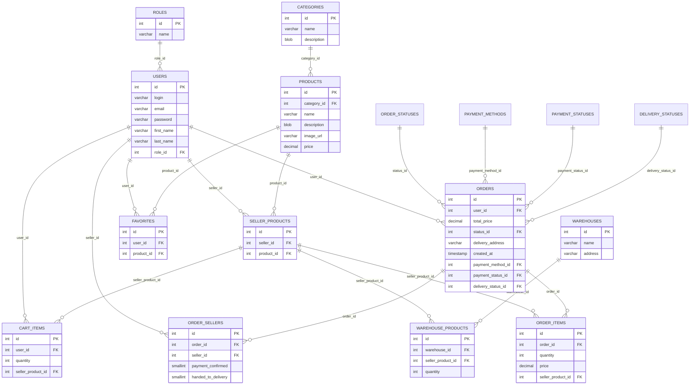

# Архитектура проекта VM²

Документ описывает, как устроен проект изнутри: слои приложения, модель данных, бизнес-процессы, транзакции, безопасность и известные ограничения.

---

## 1. Назначение и общая идея

VM² — учебный маркетплейс. Пользователь может выступать в одной из трёх ролей:

- **покупатель** (`ROLE_ID = 1`) — выбирает товары, оформляет заказы, подтверждает получение;
- **продавец** (`ROLE_ID = 2`) — добавляет товары, указывает остатки на складах, обрабатывает заказы;
- **модератор** (`ROLE_ID = 3`) — управляет справочниками категорий и складов.

Одна из главных идей проекта — **заказ может содержать товары нескольких продавцов**. Поэтому заказ разделён на две сущности:

- `ORDERS` — общая информация о заказе (покупатель, сумма, адрес, статусы);
- `ORDER_SELLERS` — участие конкретного продавца в заказе и его личные флаги (подтвердил оплату / передал товар).

Благодаря этому каждый продавец видит только свои товары в заказе и подтверждает только свою часть.

---

## 2. Слои приложения

```text
┌──────────────────────────────────────────────────────────────┐
│                        Браузер                               │
│  HTML-формы, ссылки, GET/POST-запросы                        │
└──────────────────────────────┬───────────────────────────────┘
                               │
┌──────────────────────────────▼───────────────────────────────┐
│                    Flask-приложение (app.py)                │
│  secret_key, регистрация blueprints, запуск на порту 2911   │
└──────────────────────────────┬───────────────────────────────┘
                               │
┌──────────────────────────────▼───────────────────────────────┐
│                     Blueprints (routes/*.py)                 │
│  auth │ catalog │ cart │ orders │ favorites │ moderator      │
│  проверка сессии, валидация форм, SQL-запросы                │
└──────────────────────────────┬───────────────────────────────┘
                               │
┌──────────────────────────────▼───────────────────────────────┐
│                  firebird-driver (db.py)                     │
│  connect(database, user, password)                           │
└──────────────────────────────┬───────────────────────────────┘
                               │
┌──────────────────────────────▼───────────────────────────────┐
│                    Firebird 5.1                              │
│  таблицы, внешние ключи, CHECK-ограничения, генераторы,      │
│  триггеры                                                    │
└──────────────────────────────┬───────────────────────────────┘
                               │
┌──────────────────────────────▼───────────────────────────────┐
│                  Jinja2-шаблоны (templates/*.html)           │
│  base.html + дочерние шаблоны, flash-сообщения               │
└──────────────────────────────────────────────────────────────┘
```

### 2.1. Точка входа

`app.py`:

- создаёт объект `Flask`;
- задаёт `secret_key` для подписи cookie сессии;
- регистрирует blueprint-ы;
- запускает сервер на порту `2911` в режиме отладки.

```python
app = Flask(__name__)
app.secret_key = "vm-secret-key"

app.register_blueprint(cart_bp)
app.register_blueprint(auth_bp)
# ...
```

### 2.2. Подключение к базе

`db.py` содержит единственную функцию:

```python
def get_connection():
    return connect(
        database="/db/wb_vasa.fdb",
        user="SYSDBA",
        password="masterkey",
    )
```

Особенности:

- новое соединение открывается на каждый запрос;
- пул соединений не используется;
- параметры подключения не вынесены в конфигурацию.

Для курсового проекта это допустимое упрощение, но в реальной системе так делать не стоит.

### 2.3. Blueprints

| Blueprint | URL-префикс | Файл | Зона ответственности |
|---|---|---|---|
| `main` | `/` | `routes/main.py` | главная страница и личный кабинет |
| `auth` | `/` | `routes/auth.py` | вход, регистрация, выход, профиль |
| `catalog` | `/` | `routes/catalog.py` | каталог, товары продавца, заказы продавца |
| `cart` | `/cart` | `routes/cart.py` | корзина |
| `orders` | `/` | `routes/orders.py` | оформление заказа, оплата, история |
| `favorites` | `/favorites` | `routes/favorites.py` | избранное |
| `moderator` | `/moderator` | `routes/moderator.py` | категории и склады |

Полная таблица маршрутов — в [ROUTES.md](ROUTES.md).

---

## 3. Модель данных

### 3.1. ER-диаграмма



### 3.2. Ключевая идея разделения товара и предложения продавца

В схеме есть две сущности:

- `PRODUCTS` — карточка товара: название, описание, изображение, цена, категория;
- `SELLER_PRODUCTS` — связка «продавец продаёт этот товар».

Теоретически один и тот же товар могут продавать несколько продавцов. Тогда у одного `PRODUCTS` будет несколько `SELLER_PRODUCTS`. Остатки хранятся уже на уровне `SELLER_PRODUCTS`:

```text
PRODUCTS (карточка)
   │
   ├── SELLER_PRODUCTS (продавец A)
   │      └── WAREHOUSE_PRODUCTS (остатки на складах)
   │
   └── SELLER_PRODUCTS (продавец B)
          └── WAREHOUSE_PRODUCTS (остатки на складах)
```

На практике текущий интерфейс создаёт товар и `SELLER_PRODUCTS` одновременно, поэтому один товар обычно принадлежит одному продавцу. Но схема допускает несколько продавцов, и это стоит упомянуть на защите.

---

## 4. Аутентификация и сессия

### 4.1. Вход

`routes/auth.py::login`:

1. Получает `login` и `password` из формы.
2. Ищет пользователя по логину.
3. Сравнивает пароль **напрямую** (без хеширования).
4. Записывает в сессию:
   - `user_id` — ID пользователя;
   - `user_login` — логин;
   - `user_role` — ID роли (1, 2 или 3).

```python
session["user_id"] = user[0]
session["user_login"] = user[1]
session["user_role"] = user[3]
```

### 4.2. Проверка доступа

В проекте нет декораторов `@login_required` / `@role_required`. Проверка выполняется вручную в начале каждого обработчика:

```python
if not session.get("user_id"):
    return redirect(url_for("auth.login"))

if session.get("user_role") != 2:
    return redirect(url_for("catalog.catalog"))
```

Модератор проверяется отдельной функцией:

```python
def check_moderator_access():
    if "user_id" not in session:
        return False
    if session.get("user_role") != 3:
        return False
    return True
```

Такой подход работает, но дублируется. В будущем его стоит заменить декораторами.

### 4.3. Выход

`/logout` вызывает `session.clear()` и перенаправляет на главную.

---

## 5. Бизнес-процессы

### 5.1. Каталог

`routes/catalog.py::catalog` собирает SQL-запрос динамически:

- фильтр по категории: `p.CATEGORY_ID = ?`;
- поиск по названию: `p.NAME CONTAINING ?`;
- минимальная и максимальная цена: `p.PRICE >= ?`, `p.PRICE <= ?`;
- сортировка: по цене возрастанию/убыванию или по названию.

Особенность Firebird: `CONTAINING` выполняет поиск подстроки без учёта регистра в зависимости от collateral-набора символов.

### 5.2. Карточка товара

`routes/catalog.py::product`:

- получает товар, категорию и суммарный остаток по всем складам:

```sql
COALESCE(SUM(wp.QUANTITY), 0) AS QUANTITY
```

- если пользователь авторизован, проверяет, есть ли товар в избранном.

### 5.3. Корзина

`routes/cart.py`:

- `cart_add` — добавляет товар в корзину или увеличивает количество на 1;
- `cart` — показывает корзину и суммарный остаток;
- `cart_select` — сохраняет выбранные позиции в сессию (`cart_selected`);
- `cart_update` — меняет количество с проверкой остатка;
- `cart_remove` — удаляет позицию.

Важная деталь: **выбор товаров хранится в сессии**, а не в базе. В `session["cart_selected"]` лежит список ID строк `CART_ITEMS`.

При добавлении в корзину проверяется суммарный остаток:

```sql
SELECT COALESCE(SUM(QUANTITY), 0)
FROM WAREHOUSE_PRODUCTS
WHERE SELLER_PRODUCT_ID = ?
```

Если текущее количество в корзине + 1 превышает остаток, добавление блокируется.

### 5.4. Оформление заказа

`routes/orders.py::checkout` — самый сложный обработчик.

Шаги:

1. Проверить авторизацию.
2. Взять `cart_selected` из сессии.
3. Загрузить выбранные позиции корзины.
4. Посчитать итоговую сумму.
5. При POST:
   - проверить адрес доставки;
   - проверить способ оплаты;
   - создать запись в `ORDERS`;
   - определить всех продавцов, чьи товары входят в заказ;
   - создать по строке в `ORDER_SELLERS` для каждого продавца;
   - для каждой позиции:
     - проверить суммарный остаток;
     - списать количество со складов (начиная с меньшего `WAREHOUSE_ID`);
     - создать строку в `ORDER_ITEMS`;
     - удалить позицию из корзины;
   - зафиксировать транзакцию.

Схема:

```text
Корзина (CART_ITEMS)
   │
   ├── выбрать позиции
   ▼
ORDERS (общая сумма, адрес, статусы)
   │
   ├── ORDER_SELLERS (по одной строке на продавца)
   │
   └── ORDER_ITEMS (по одной строке на товар)
          │
          └── списание остатков из WAREHOUSE_PRODUCTS
```

Все действия выполняются в одной транзакции. Если хотя бы один товар не удалось зарезервировать, вызывается `rollback()`, и заказ не создаётся.

### 5.5. Оплата

В системе два способа оплаты:

| ID | Способ | Логика |
|---|---|---|
| 1 | СБП | покупатель нажимает «Я оплатил», статус оплаты становится «Ожидает проверки», затем продавцы подтверждают |
| 2 | При получении | оплата происходит при получении заказа; подтверждение оплаты продавцом не требуется |

#### СБП

1. При оформлении заказа создаётся `ORDERS` с `PAYMENT_STATUS_ID = 1` («Ожидает оплаты»).
2. Пользователь перенаправляется на `/payment/sbp/<order_id>`.
3. Нажимает «Я оплатил, честно» → `PAYMENT_STATUS_ID = 2` («Ожидает проверки»).
4. Каждый продавец в своём кабинете нажимает «Подтвердить оплату».
5. Когда все продавцы подтвердили:
   - `ORDERS.PAYMENT_STATUS_ID = 3` («Оплачено»);
   - `ORDERS.STATUS_ID = 2` («Подтверждён»).

#### При получении

1. Заказ создаётся с `PAYMENT_STATUS_ID = 1`.
2. Продавцы не подтверждают оплату — для этого способа подтверждение не требуется.
3. Продавец может передать товар в доставку без `PAYMENT_CONFIRMED`.
4. При подтверждении получения покупателем:
   - `STATUS_ID = 5` («Доставлен»);
   - `DELIVERY_STATUS_ID = 3` («Доставлен»);
   - если способ оплаты = 2, то `PAYMENT_STATUS_ID = 3` («Оплачено»).

### 5.6. Передача в доставку

`routes/catalog.py::seller_handover`:

1. Проверяет, что заказ относится к продавцу.
2. Проверяет, что заказ не завершён и не отменён.
3. Проверяет оплату:
   - для СБП требует `PAYMENT_CONFIRMED = 1` и `PAYMENT_STATUS_ID` 2 или 3;
   - для оплаты при получении разрешает передачу без подтверждения;
   - при `PAYMENT_STATUS_ID = 4` («Отклонено») передача запрещена.
4. Ставит `ORDER_SELLERS.HANDED_TO_DELIVERY = 1`.
5. Если все продавцы передали товары:
   - `ORDERS.STATUS_ID = 4` («Передан в доставку»);
   - `ORDERS.DELIVERY_STATUS_ID = 2` («В пути»).

### 5.7. Подтверждение получения

`routes/orders.py::confirm_receipt`:

1. Проверяет, что заказ принадлежит пользователю.
2. Требует `STATUS_ID = 4` и `DELIVERY_STATUS_ID = 2`.
3. Ставит:
   - `STATUS_ID = 5`;
   - `DELIVERY_STATUS_ID = 3`;
   - для оплаты при получении — `PAYMENT_STATUS_ID = 3`.

### 5.8. Товары продавца

`routes/catalog.py`:

- `my_products` — список товаров текущего продавца;
- `create_product` — создание товара:
  - проверка полей;
  - проверка категории;
  - проверка цены (`Decimal`, неотрицательная);
  - проверка расширения изображения (`.jpg`, `.jpeg`, `.png`, `.webp`);
  - сохранение файла с UUID-именем;
  - вставка в `PRODUCTS`, `SELLER_PRODUCTS`, `WAREHOUSE_PRODUCTS`;
  - при ошибке — `rollback` и удаление загруженного файла;
- `edit_product` — редактирование и обновление остатков;
- `delete_product` — удаление товара и связанных остатков.

### 5.9. Заказы продавца

`routes/catalog.py::seller_orders`:

- выбирает заказы, в которых есть товары продавца;
- группирует строки по `ORDER_ID` в Python;
- считает сумму только по товарам этого продавца.

Запрос соединяет:

```text
ORDER_SELLERS → ORDERS → ORDER_ITEMS → SELLER_PRODUCTS → PRODUCTS
```

и справочники статусов.

### 5.10. Избранное

`routes/favorites.py`:

- `favorites_add` — добавляет товар, если его ещё нет;
- `favorites_remove` — удаляет;
- `favorites` — показывает список избранных товаров.

### 5.11. Модератор

`routes/moderator.py`:

- CRUD категорий;
- CRUD складов;
- проверка роли через `check_moderator_access()`;
- удаление категории/склада может упасть из-за внешних ключей — ошибка перехватывается и показывается пользователю.

---

## 6. Статусные модели

### 6.1. Заказ

```text
1 Новый
   │ все продавцы подтвердили оплату
   ▼
2 Подтверждён
   │ (зарезервировано: 3 Собирается)
   ▼
4 Передан в доставку
   │ покупатель подтвердил получение
   ▼
5 Доставлен

6 Отменён — зарезервирован, автоматических переходов нет
```

### 6.2. Оплата

```text
1 Ожидает оплаты
   │ покупатель нажал «Я оплатил» (СБП)
   ▼
2 Ожидает проверки
   │ все продавцы подтвердили
   ▼
3 Оплачено

4 Отклонено — зарезервирован
```

### 6.3. Доставка

```text
1 Не отправлен
   │ все продавцы передали товары
   ▼
2 В пути
   │ покупатель подтвердил получение
   ▼
3 Доставлен

4 Отменён — зарезервирован
```

### 6.4. Флаги продавца

```text
PAYMENT_CONFIRMED = 0 → 1  (подтверждение оплаты)
HANDED_TO_DELIVERY = 0 → 1 (передача товара)
```

Когда все строки `ORDER_SELLERS` по заказу имеют `PAYMENT_CONFIRMED = 1`, обновляется статус заказа. Аналогично для `HANDED_TO_DELIVERY`.

---

## 7. Транзакции и работа с остатками

### 7.1. Где используются транзакции

Транзакции явно применяются в:

- регистрации;
- оформлении заказа;
- подтверждении оплаты продавцом;
- передаче товара;
- подтверждении получения;
- создании/редактировании/удалении товара;
- работе с корзиной и избранным.

Типовой шаблон:

```python
try:
    # SQL-запросы
    connection.commit()
except Exception:
    connection.rollback()
    raise
finally:
    connection.close()
```

### 7.2. Списание остатков

При оформлении заказа остатки списываются по алгоритму:

```text
для каждого товара:
    получить все склады с QUANTITY > 0 (по возрастанию WAREHOUSE_ID)
    если суммарный остаток < нужного количества:
        rollback и ошибка
    остаток_к_списанию = нужное количество
    для каждого склада:
        списать min(остаток_склада, остаток_к_списанию)
        если UPDATE затронул не одну строку:
            ошибка
    если остаток_к_списанию != 0:
        ошибка
```

Это корректно с точки зрения логики, но **без блокировки строк** (`WITH LOCK` / `FOR UPDATE`) возможна ситуация, когда два покупателя одновременно оформят последний товар. В учебном проекте этим пренебрегли.

### 7.3. Почему остатки не хранятся в `PRODUCTS`

Потому что остаток зависит от продавца и склада. Один товар может продаваться разными продавцами и лежать на разных складах. Поэтому:

- `PRODUCTS` — описание товара;
- `SELLER_PRODUCTS` — предложение продавца;
- `WAREHOUSE_PRODUCTS` — количество на конкретном складе.

---

## 8. Безопасность

### 8.1. Что сделано хорошо

- **Параметризованные SQL-запросы**. Вместо подстановки строк используются `?`, что защищает от SQL-инъекций:

```python
cursor.execute("SELECT * FROM USERS WHERE LOGIN = ?", (login,))
```

- **Проверка расширения файла** при загрузке изображения.
- **UUID-имена файлов** — исключают коллизии и подмену имени.
- **Проверка роли** в обработчиках продавца и модератора.
- **Проверка принадлежности** заказа/товара пользователю перед изменением.
- **CHECK-ограничения** в БД: количество больше нуля, цена неотрицательная.

### 8.2. Что требует доработки

| Проблема | Последствие | Рекомендация |
|---|---|---|
| Пароли в открытом виде | утечка паролей при утечке БД | `werkzeug.security.generate_password_hash` / `check_password_hash` |
| `secret_key` в коде | подделка сессии | вынести в переменные окружения |
| Нет CSRF-токенов | CSRF-атаки | Flask-WTF |
| `debug=True` | раскрытие отладочной информации | выключить в продакшене |
| Нет ограничения размера файла | переполнение диска | `MAX_CONTENT_LENGTH`, проверка MIME |
| Нет HTTPS | перехват трафика | reverse proxy + HTTPS |
| Нет rate limiting | брутфорс | Flask-Limiter |
| Пароли БД в коде | компрометация БД | конфигурация через env |
| Нет проверки прав на `/favorites` | `KeyError` при прямом заходе | добавить проверку сессии |

---

## 9. Обработка ошибок

В проекте используется несколько подходов:

1. **Flash-сообщения** — для пользовательских ошибок:
   - «Заполните все поля»;
   - «Неверный логин или пароль»;
   - «Товара осталось только N шт.»;
   - «Невозможно удалить категорию, так как в ней есть товары».

2. **HTTP 400** — при ошибках валидации форм в `auth` и `catalog.create_product`.

3. **`try/except/rollback`** — при операциях записи.

4. **Логирование** — в `catalog.py` используется `current_app.logger.exception` для ошибок редактирования/удаления товара.

5. **Молчаливое проглатывание** — в `orders.checkout` общий `except Exception` показывает «Не удалось оформить заказ», не раскрывая причину. Для отладки стоит логировать исключение.

---

## 10. Известные ограничения и технический долг

### 10.1. Функциональные

- Нет отмены заказа покупателем.
- Нет статуса «Собирается» в реальном процессе.
- Нет управления пользователями у модератора.
- Нет модерации товаров.
- Нет пагинации.
- Нет поиска по описанию.
- Нет нескольких изображений у товара.
- Нет истории изменения статусов.

### 10.2. Логические ошибки

1. **`cart_add` выбирает первого продавца.** Запрос `SELECT ID FROM SELLER_PRODUCTS WHERE PRODUCT_ID = ?` без `ORDER BY` и без учёта продавца. Если товар продают несколько продавцов, в корзину попадёт произвольное предложение.

2. **Каталог может показывать дубликаты.** `JOIN SELLER_PRODUCTS` вернёт несколько строк, если товар продают несколько продавцов.

3. **Некорректные числовые параметры каталога.** `int(selected_category)` и `float(min_price)` без `try/except` приведут к 500 при ручном изменении URL.

4. **Гонки при списании остатков.** Нет блокировки строк склада.

5. **Дублирующиеся триггеры `FAVORITES`.** В текущей базе есть и `BI_FAVORITES_ID`, и `TRIGGER_BI_FAVORITES_ID`. Оба срабатывают BEFORE INSERT и перезаписывают `NEW.ID`. Работает, но одна из генераторных последовательностей расходуется впустую. В чистом скрипте `sql/01_schema.sql` оставлен один триггер.

6. **`routes/__init.py__`** — файл назван неверно (должен быть `__init__.py`). На работу не влияет, потому что импорт идёт напрямую из модулей.

7. **`print` в коде.** В `auth.register` и `orders` остались отладочные `print`.

### 10.3. Архитектурный долг

- Нет фабрики приложения (`create_app`) — тестировать сложнее.
- Нет конфигурации через переменные окружения.
- Нет миграций — схема меняется вручную.
- Нет автотестов.
- Нет ORM — плюс для демонстрации SQL, минус для скорости разработки.
- Нет слоя репозиториев — SQL размазан по обработчикам.
- Нет индексов на части внешних ключей в текущей базе.
- Новое соединение на каждый запрос — нет пула.
- Нет централизованной обработки ошибок (`@app.errorhandler`).

---

## 11. Направления развития

1. **Безопасность**
   - хеширование паролей;
   - CSRF;
   - вынести секреты в `.env`;
   - декораторы `@login_required`, `@role_required`;
   - ограничение загрузки файлов.

2. **Бизнес-логика**
   - отмена заказа;
   - статус «Собирается»;
   - возвраты;
   - несколько изображений;
   - уведомления.

3. **Производительность**
   - индексы на внешние ключи;
   - пагинация;
   - пул соединений;
   - `WITH LOCK` при списании остатков.

4. **Качество кода**
   - фабрика приложения;
   - конфигурация;
   - тесты (pytest + test database);
   - логирование;
   - единый стиль.

5. **Инфраструктура**
   - Docker Compose с Firebird;
   - CI;
   - скрипты резервного копирования `gbak`.

---

## 12. Как проект защищать на курсовой

Короткий план ответа:

1. **Тема:** маркетплейс с ролями покупателя, продавца и модератора.
2. **Стек:** Flask + Firebird, SQL без ORM.
3. **Архитектура:** blueprints, шаблоны Jinja2, отдельный модуль подключения к БД.
4. **Модель данных:** 16 таблиц, справочники статусов, связь товара и продавца через `SELLER_PRODUCTS`, остатки через `WAREHOUSE_PRODUCTS`.
5. **Сложная часть:** заказ с товарами нескольких продавцов, `ORDER_SELLERS`, поэтапное подтверждение оплаты и передачи.
6. **Транзакции:** оформление заказа в одной транзакции, списание остатков, rollback при нехватке.
7. **Ограничения:** честно назвать plaintext-пароли, отсутствие CSRF, гонки остатков и пути улучшения.

Этого достаточно, чтобы показать понимание не только «как работает сайт», но и «как устроена база и бизнес-процесс».
